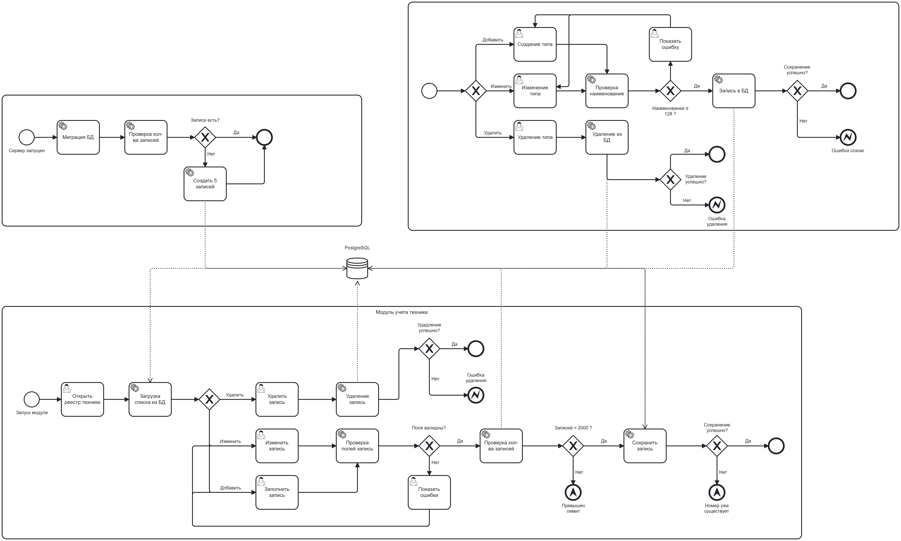

# Модуль ведения БД компьютерной техники

Посмотреть: https://test-riit.lumenustech.ru

Клиент-серверное приложение для учёта техники (учётный номер, наименование, тип техники, номер комнаты размещения).

## Стек

| Слой      | Технология                                          |
|-----------|-----------------------------------------------------|
| Backend   | ASP.NET Core (net10.0 — соответствует «.NET Core от 3.1»), EF Core + Npgsql |
| Frontend  | DevExtreme JavaScript UI Components for jQuery (25.1.15), dxDataGrid |
| СУБД      | PostgreSQL 16 (требование задания: ≥ 12)            |
| Раздача UI| nginx (статику + проксирование `/api/` на backend)  |

## Бизнес логика



## Структура

- `Bakcend/` — REST API (`/api/technic` CRUD, `/api/technicType` справочник типов)
- `Frontend/` — DevExtreme (`index.html`, `js/app.js`, `css/styles.css`)
- `docker-compose.yml` — сервисы `db`, `backend`, `client`
- `nginx.conf` — конфиг nginx для клиента

## Запуск (Docker)

```bash
docker compose up -d --build
```

| Что        | Адрес                                   |
|------------|-----------------------------------------|
| Клиент     | http://localhost:8090                   |
| API        | http://localhost:8082/api/technic      |
| PostgreSQL | localhost:5432 (hardware / hardware)    |

Схема БД применяется автоматически при старте backend через EF Core Migrations (`Database.Migrate()`), после чего, если словарь типов пуст, он заполняется демо-позициями (`DatabaseInitializer`).

Если БД была создана до перехода на миграции (старый volume через `EnsureCreated`), пересоздайте её: `docker compose down -v && docker compose up -d --build`.

## Запуск без Docker

1. Поднимите PostgreSQL 12+ с БД `hardware` (логин/пароль `hardware`) — или `docker compose up -d db`.
2. Backend: `dotnet run --project Bakcend/Bakcend` → http://localhost:5115
3. Клиент: откройте `Frontend/index.html` в браузере. Если открываете напрямую из файловой системы (не через nginx), замените `API_URL` в `Frontend/js/app.js` на `http://localhost:5115/api/technic`.

## REST API

| Метод  | URL                | Описание                        |
|--------|--------------------|---------------------------------|
| GET    | /api/technic       | список всей техники             |
| GET    | /api/technic/{id}  | одна запись                     |
| POST   | /api/technic       | добавить запись                 |
| PUT    | /api/technic/{id}  | обновить запись                 |
| DELETE | /api/technic/{id}  | удалить запись                  |
| GET    | /api/technicType   | справочник типов техники        |
